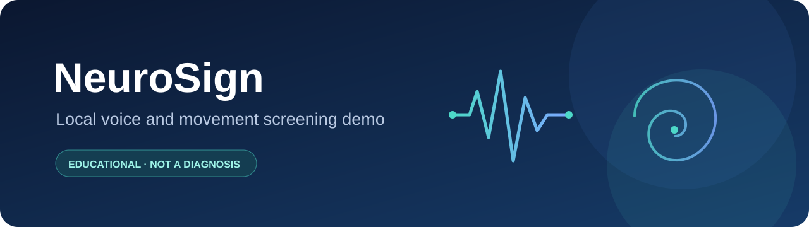
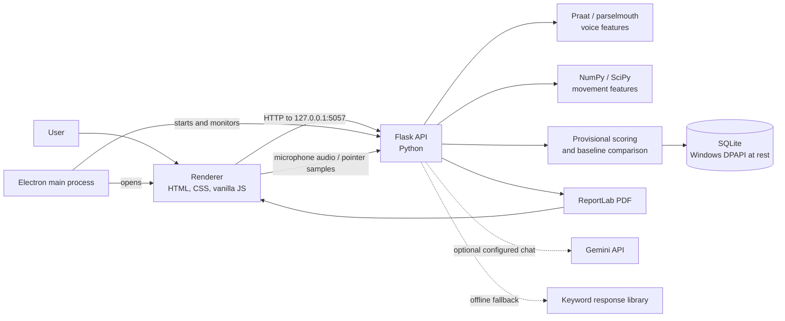
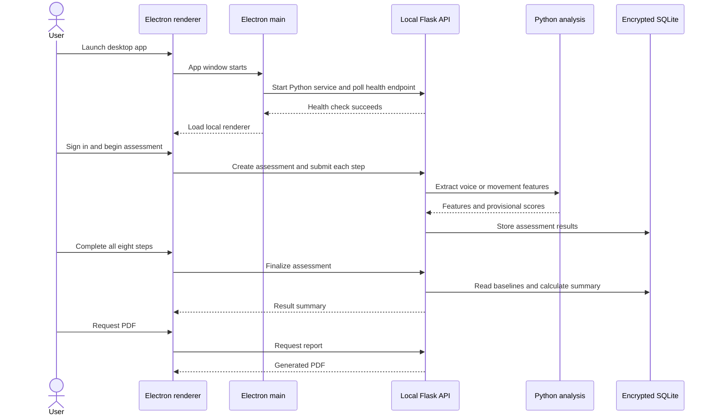

<div align="center">

# NeuroSign

### A local desktop demo exploring voice and movement signals

[](LICENSE)
[](package.json)
[](https://www.electronjs.org/)
[](https://www.python.org/)
[](https://nodejs.org/)
[](https://github.com/Luci-XO/neurosign/stargazers)
[](https://github.com/Luci-XO/neurosign/commits/main)
[](CONTRIBUTING.md)



**NeuroSign is an educational Parkinson's screening demo—not a medical device or diagnosis.**

[Explore the code](#project-structure) · [Set up NeuroSign](#quick-start) · [Read the architecture guide](docs/ARCHITECTURE.md)

</div>

---

## Table of Contents

- [What is NeuroSign?](#what-is-neurosign)
- [Features](#features)
- [Demo and screenshots](#demo-and-screenshots)
- [Architecture](#architecture)
- [Tech stack](#tech-stack)
- [Quick start](#quick-start)
- [Project structure](#project-structure)
- [How it works](#how-it-works)
- [Configuration](#configuration)
- [FAQ and troubleshooting](#faq-and-troubleshooting)
- [What's new in v2](#whats-new-in-v2)
- [Roadmap](#roadmap)
- [Contributing](#contributing)
- [License](#license)
- [Author](#author)
- [Acknowledgements](#acknowledgements)

## What is NeuroSign?

NeuroSign is a Windows desktop application that guides a person through a short sequence of voice and pointer-movement tasks. It extracts acoustic and movement features, compares measurements with provisional reference values and the user's own baseline, and presents an informational summary with an optional PDF report.

The project is intended for learning, experimentation, and demonstration of a desktop-to-local-API signal-analysis workflow. It is **not clinically validated**. Its scores cannot diagnose Parkinson's disease, confirm it, or rule it out. A healthcare professional is the right person to assess symptoms.

### The problem it explores

Voice timing and amplitude variation, as well as movement traces, can be represented as measurable signals. NeuroSign demonstrates how a desktop application can capture those signals, process them locally, and make the measurements understandable in a report. Its thresholds are experimental demo settings, not clinical decision boundaries.

### Who it is for

- Developers learning Electron, Flask, signal processing, and local desktop application architecture.
- Students exploring how to connect an interface with a Python analysis service.
- Contributors interested in improving a transparent, educational prototype.

> **Health and safety:** Do not use NeuroSign to make healthcare decisions or to delay professional advice. Results are not a diagnosis.

[Back to top](#table-of-contents)

## Features

| | Feature | What the code does |
|---|---|---|
| 🎙️ | Voice recording | Captures a sustained vowel as WAV and checks duration, signal level, clipping, and voiced-frame quality. |
| 📊 | Acoustic features | Uses Praat through parselmouth to extract pitch, jitter, shimmer, and harmonic-to-noise ratio. |
| ✍️ | Guided movement tasks | Captures spiral, wave, and free-shape pointer traces, then calculates signal and smoothness features. |
| 📈 | Personal baseline comparison | Compares the detection voice and movement steps against earlier measurements from the same assessment. |
| 🧾 | Result summary and PDF | Shows stage measurements and screening flags; ReportLab builds a PDF with charts and exercise cards. |
| 🔐 | Local account flow | Provides account registration, password hashing, recovery codes, token expiry, and failed-login lockout. |
| 💾 | Local encrypted database | Stores SQLite data and uses Windows DPAPI to encrypt the database file at rest. |
| 🌗 | Theme toggle | Offers a dark/light theme preference in the renderer. |
| 💬 | Optional health chat | Uses Gemini when configured and reachable, with a small keyword-based offline fallback. |

These are software features, not claims of clinical accuracy. The voice Random Forest model is optional and its probability is not the final rule-based screening verdict.

[Back to top](#table-of-contents)

## Demo and screenshots

Screenshots and a recording have not been added yet. Capture the following from the running app and place them in `docs/assets/`:

- `home.png` — home screen and navigation.
- `assessment.png` — one voice or guided movement step using synthetic/demo information only.
- `results.png` — result screen with names and identifying information removed.
- `report-preview.png` — PDF report preview with all personal information obscured.
- `neurosign-demo.gif` — short walkthrough of the assessment flow, if desired.

Do not commit real names, health information, recordings, API keys, or database files in screenshots or GIFs.

<!-- Add screenshots when available:


-->

[Back to top](#table-of-contents)

## Architecture

NeuroSign has an Electron desktop shell, a local HTML/CSS/JavaScript renderer, and a Python Flask service on loopback. The renderer makes HTTP requests to the local API; the backend performs analysis, persistence, and report generation.



### Assessment flow



The backend database currently depends on Windows DPAPI. The application is therefore documented as Windows-only; the Electron launcher’s POSIX interpreter fallback does not make the encrypted database implementation portable.

See [docs/ARCHITECTURE.md](docs/ARCHITECTURE.md) for the component and data-flow deep dive.

[Back to top](#table-of-contents)

## Tech stack

| Area | Technology | Role |
|---|---|---|
| Desktop runtime | [Electron 31](https://www.electronjs.org/) | Opens the desktop window and manages the local backend process. |
| User interface | HTML, CSS, vanilla JavaScript | Screens, recording controls, movement canvas, results, and chat UI. |
| Backend API | [Python 3.11](https://www.python.org/) and [Flask 3](https://flask.palletsprojects.com/) | Local HTTP API, account routes, analysis orchestration, and PDF endpoint. |
| Voice analysis | [Praat](https://www.fon.hum.uva.nl/praat/) via [parselmouth](https://parselmouth.readthedocs.io/) | Pitch, jitter, shimmer, and harmonicity measurements. |
| Numerical analysis | [NumPy](https://numpy.org/) and [SciPy](https://scipy.org/) | Array operations, filtering, resampling, and movement frequency analysis. |
| Optional ML | [scikit-learn](https://scikit-learn.org/) and joblib | Random Forest model training and loading. |
| Persistence | SQLite and Windows DPAPI | Relational local storage and Windows-user-scoped encryption at rest. |
| PDF | [ReportLab](https://www.reportlab.com/opensource/) | Report text, tables, charts, and exercise illustrations. |
| Optional chat | Gemini API and offline keyword fallback | General health-topic chat when configured; fallback runs locally. |
| Tests / checks | Python `unittest`, Ruff, Node syntax checks | Focused movement tests and lightweight static checks. |

[Back to top](#table-of-contents)

## Quick start

### Prerequisites

- Windows 10 or later (required by the current DPAPI database implementation).
- Node.js 20 or later and npm.
- Python 3.11.
- A microphone for voice steps.
- A mouse or compatible pointer device for movement steps.

### Windows

<details>
<summary>Install and run NeuroSign on Windows</summary>

Open PowerShell:

```powershell
git clone https://github.com/Luci-XO/neurosign.git
Set-Location neurosign

npm ci
py -3.11 -m venv backend\venv
backend\venv\Scripts\python.exe -m pip install --upgrade pip
backend\venv\Scripts\python.exe -m pip install -r backend\requirements.txt

Copy-Item .env.example .env
npm start
```

`GEMINI_API_KEY` is optional. Leave it empty to use Neuro's offline keyword-based fallback. If you add a key, keep `.env` private; chat messages can be sent to the configured external Gemini service.

On first launch the backend initializes its local database. Use the same Windows account for later runs because DPAPI encryption is tied to that account.

</details>

### macOS

<details>
<summary>Development setup on macOS (application runtime is currently unsupported)</summary>

The current backend explicitly requires Windows DPAPI to initialize encrypted storage. These commands can prepare dependencies, but **the full application will not run successfully on macOS until database encryption has a supported implementation**.

```bash
git clone https://github.com/Luci-XO/neurosign.git
cd neurosign
npm ci
python3.11 -m venv backend/venv
backend/venv/bin/python -m pip install --upgrade pip
backend/venv/bin/python -m pip install -r backend/requirements.txt
cp .env.example .env
```

</details>

### Linux

<details>
<summary>Development setup on Linux (application runtime is currently unsupported)</summary>

The current backend explicitly requires Windows DPAPI to initialize encrypted storage. These commands can prepare dependencies, but **the full application will not run successfully on Linux until database encryption has a supported implementation**.

```bash
git clone https://github.com/Luci-XO/neurosign.git
cd neurosign
npm ci
python3.11 -m venv backend/venv
backend/venv/bin/python -m pip install --upgrade pip
backend/venv/bin/python -m pip install -r backend/requirements.txt
cp .env.example .env
```

</details>

More detail, including model and data limitations, is in [docs/SETUP.md](docs/SETUP.md).

[Back to top](#table-of-contents)

## Project structure

```text
neurosign/
├── .github/                 GitHub issue/PR templates and CI
├── backend/
│   ├── analysis/            Voice, movement, scoring, and summary logic
│   ├── ml/                  Voice-model training script (dataset/model are local-only)
│   ├── routes/              Flask API route blueprints
│   ├── app.py               Flask application and authentication routes
│   ├── config.py            Environment-backed configuration
│   ├── db.py                SQLite initialization and Windows DPAPI encryption
│   ├── requirements.txt     Pinned runtime Python dependencies
│   ├── requirements-dev.txt Python lint dependency
│   ├── schema.sql           SQLite schema
│   └── test_movement_features.py
├── docs/
│   ├── assets/              Banner and future screenshots
│   ├── ARCHITECTURE.md      Component and data-flow notes
│   └── SETUP.md             Installation and troubleshooting
├── electron/
│   ├── main.js              Starts backend and creates the app window
│   └── preload.js           Narrow renderer bridge
├── renderer/
│   ├── css/                 Application styles
│   ├── img/                 Logo and exercise illustrations
│   ├── js/                  UI, authentication, recording, and tracing
│   └── index.html           Application screens
├── package.json             Electron scripts and metadata
└── .env.example             Safe configuration template
```

The training dataset, trained model, SQLite database, `.env`, and Python virtual environments are deliberately not distributed as source files.

[Back to top](#table-of-contents)

## How it works

1. Electron starts the Python backend and checks `GET /api/health`.
2. The renderer loads after the backend responds.
3. The user signs in and enters a profile for an assessment.
4. Voice steps record a sustained vowel and upload a temporary WAV. The backend checks recording quality, extracts features, and deletes the temporary file.
5. Movement steps record timestamped pointer coordinates. The backend validates and processes the trace.
6. The scoring code calculates provisional stage scores and compares detection steps with earlier baseline measurements.
7. On completion, the backend creates the result summary. The PDF endpoint uses that summary to render a report.

<details>
<summary>Backend deep dive</summary>

The Flask app registers route blueprints for assessments, step analysis, reports, and Neuro chat. Account routes live in `backend/app.py`. SQLite schema is defined in `backend/schema.sql`; the database helper serializes it in memory and encrypts the persisted database with Windows DPAPI. Voice analysis uses parselmouth/Praat; movement analysis uses NumPy and SciPy. `backend/analysis/scoring.py` owns demo reference values and verdict thresholds.

The Random Forest probability is stored if a local trained model file exists. It is not currently used by the final verdict calculation. The repository excludes both the model artifact and the source dataset, so a fresh clone will not have the optional model file unless it is trained separately.

</details>

<details>
<summary>Electron main process deep dive</summary>

`electron/main.js` finds `backend/venv/Scripts/python.exe` on Windows, starts `app.py` from the backend directory, polls the health route, then creates a `BrowserWindow`. The window uses `contextIsolation: true` and `nodeIntegration: false`; `electron/preload.js` exposes the local API base URL to the renderer. The main process stops the backend when the app exits.

</details>

<details>
<summary>Renderer deep dive</summary>

`renderer/js/app.js` handles the screens, step progression, API calls, result view, and report actions. `recorder.js` captures and encodes the microphone input. `tracer.js` draws movement guides and captures pointer events. `auth.js`, `theme.js`, and `neuro.js` handle their respective interface features. The renderer uses browser APIs and `fetch`; it does not have direct Node.js integration.

</details>

See [docs/ARCHITECTURE.md](docs/ARCHITECTURE.md) for more about measurements, storage, and security boundaries.

[Back to top](#table-of-contents)

## Configuration

The backend loads environment variables from the project-root `.env` file using `python-dotenv`.

| Variable | Default | Purpose |
|---|---|---|
| `NEUROSIGN_PORT` | `5057` | Port used by the Flask service. The Electron health-check and renderer URL are currently also hardcoded to `5057`; changing only this variable will break communication. |
| `NEUROSIGN_DB_PATH` | `neurosign.db` | Database filename under `backend/`. |
| `NEUROSIGN_DEBUG` | `false` | Flask debug setting. Keep disabled for normal use. |
| `GEMINI_API_KEY` | empty | Optional key for the online chat. Without it, Neuro uses its offline fallback. |
| `GEMINI_MODEL` | `gemini-1.5-flash` | Model name passed to the optional Gemini client. |

Copy `.env.example` to `.env` to start. Do not commit `.env` or paste credentials into public issues.

[Back to top](#table-of-contents)

## FAQ and troubleshooting

<details>
<summary>Why does the app say the backend did not start?</summary>

Check that `backend/venv` exists and that its Python dependencies installed successfully. Read the terminal output for the Python error. Also check whether another NeuroSign instance is using port `5057`. The Electron process waits for `/api/health` before opening the window.

</details>

<details>
<summary>Why does Electron say Python was not found?</summary>

Create the expected environment from the project root:

```powershell
py -3.11 -m venv backend\venv
backend\venv\Scripts\python.exe -m pip install -r backend\requirements.txt
```

Electron checks `backend/venv/Scripts/python.exe` on Windows and otherwise falls back to `python` on `PATH`. The database implementation still requires Windows DPAPI.

</details>

<details>
<summary>Why can't I open the database on another account or computer?</summary>

Database encryption uses Windows DPAPI and is scoped to the Windows account that encrypted it. The app expects the same account on the same device context. Keep backups secure; do not assume an encrypted database can be transferred and decrypted on another machine.

</details>

<details>
<summary>Does the optional Gemini chat keep all data local?</summary>

No. If `GEMINI_API_KEY` is configured and the service is reachable, chat messages and the submitted recent conversation history are sent to Gemini. Voice and movement analysis and SQLite storage are local. Leave the key blank to use the offline keyword response library.

</details>

<details>
<summary>Why is there no voice-model result on a fresh install?</summary>

The trained `voice_rf.joblib` model is excluded from the repository. The backend only loads the optional model if the file exists. The training script also expects `backend/parkinsons.data`, which is not distributed with this project. The final rule-based screening verdict does not depend on the optional model probability.

</details>

<details>
<summary>Can I use the result to tell whether I have Parkinson's?</summary>

No. NeuroSign is an experimental demo with provisional thresholds. It cannot diagnose Parkinson's or rule it out. Talk with a qualified healthcare professional about symptoms or concerns.

</details>

[Back to top](#table-of-contents)

## What's new in v2

Compared with the original tracked commit, the current v2 worktree adds or expands:

| Area | v2 change |
|---|---|
| Accounts | Registration, sign-in, password recovery, hashed passwords, lockout, and expiring bearer tokens. |
| Data protection | Windows DPAPI encryption for the local SQLite database and migration/backup handling. |
| Movement analysis | Guided path deviation measured against the displayed path at matching progress, plus updated scoring and summary handling. |
| Reports | Expanded PDF content with score explanations, charting, and exercise illustrations. |
| User experience | Updated results and exercise cards, dark/light theme, and an in-app Neuro chat. |
| Repository setup | Pinned Python requirements, local environment configuration, focused tests, and GitHub project templates/CI. |

The first repository commit is still the only commit on `main` at this phase; v2 changes are currently workspace changes, not a published release. Claims in this table describe code present in the workspace, not clinical validation.

[Back to top](#table-of-contents)

## Roadmap

- [x] Add an Electron desktop shell and local Flask API.
- [x] Implement voice and guided pointer-movement capture.
- [x] Add local assessment persistence and PDF report generation.
- [x] Add Windows-local database encryption.
- [x] Add project setup, contribution, security, and community documentation.
- [ ] Add privacy-safe screenshots and a short demo recording.
- [ ] Validate installation and CI on a clean Windows machine.
- [ ] Review and resolve dependency security advisories.
- [ ] Evaluate port configuration so the setting and Electron URLs cannot drift.
- [ ] Conduct appropriate independent evaluation before making any clinical performance claims.

[Back to top](#table-of-contents)

## Contributing

Issues and pull requests are welcome. Read [CONTRIBUTING.md](CONTRIBUTING.md) first. Do not submit credentials, health data, or recordings. Keep claims about screening and model performance evidence-based.

[Open an issue](https://github.com/Luci-XO/neurosign/issues) · [Read the security policy](SECURITY.md)

[Back to top](#table-of-contents)

## License

NeuroSign is released under the [MIT License](LICENSE).

[Back to top](#table-of-contents)

## Author

Created and maintained by [Luci-XO](https://github.com/Luci-XO).

[Back to top](#table-of-contents)

## Acknowledgements

- [Praat](https://www.fon.hum.uva.nl/praat/) and [parselmouth](https://parselmouth.readthedocs.io/) for speech-analysis tooling.
- The [UCI Parkinson's Disease Classification dataset](https://archive.ics.uci.edu/dataset/174/parkinsons) is referenced by the optional model-training script. The dataset itself is not included in this repository.
- The open-source maintainers of Electron, Flask, NumPy, SciPy, scikit-learn, SQLite, and ReportLab.

---

<div align="center">

If NeuroSign is useful for learning or experimentation, consider giving the repository a ⭐.

[⭐ Star NeuroSign](https://github.com/Luci-XO/neurosign)

<a href="#table-of-contents">Back to top ↑</a>

</div>
